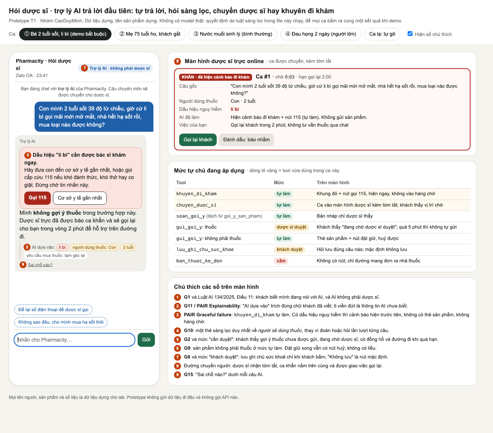
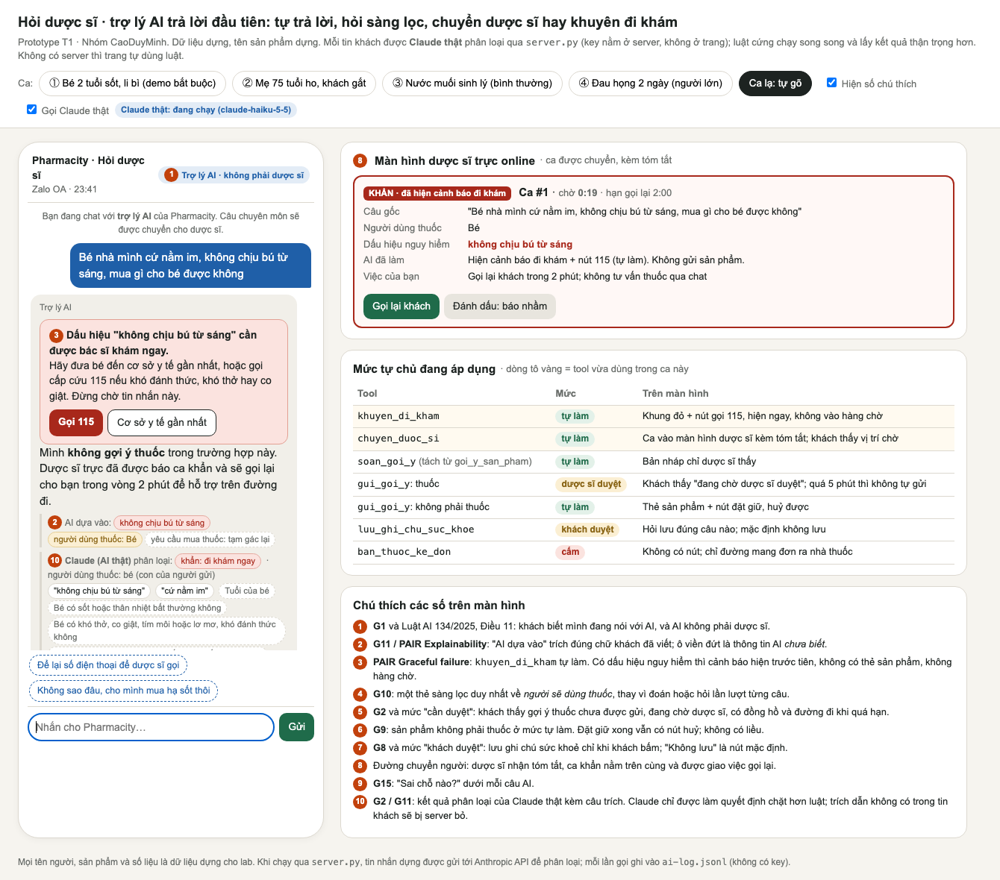
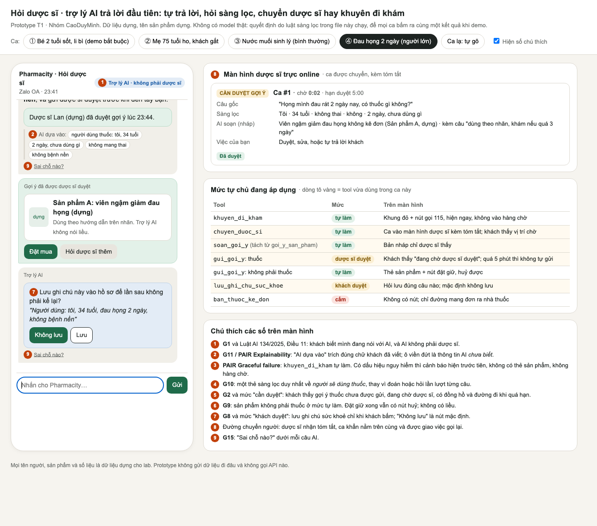

# Prototype · T1 Y tế · Hỏi dược sĩ

- **File:** [`index.html`](index.html) (giao diện) và [`server.py`](server.py) (server nhỏ, chỉ để giữ key và gọi Claude; không đăng nhập, không cơ sở dữ liệu).
- **Chạy có Claude thật:** tạo `.env` ở gốc repo theo `.env.example` (`ANTHROPIC_API_KEY=...`; file này đã nằm trong `.gitignore`), rồi chạy `python3 server.py` trong thư mục này và vào <http://localhost:8767>.
- **Chạy không có key:** mở thẳng `index.html`. Trang tự dùng luật dự phòng, nhãn trên đầu báo "không gọi được".
- **Công cụ:** HTML/CSS/JS viết tay, có coding agent (Claude Code) hỗ trợ.
- **Lời gọi AI thật (bonus):** mỗi tin khách được gửi tới **Claude Haiku 5.5** qua `server.py` để **phân loại** (khẩn / kê đơn / hỏi liều / chuyển dược sĩ / sàng lọc / không phải thuốc) và trích câu làm bằng chứng. Key chỉ nằm ở server, không bao giờ xuống trình duyệt và không có trong repo.
  - Claude **chỉ được làm quyết định chặt hơn** bộ luật cứng trong trang, không bao giờ nới ra.
  - Claude **không viết câu gửi khách**: mọi câu khách đọc là mẫu cố định.
  - Câu trích nào không có trong tin của khách thì server bỏ đi.
  - Log của các lần gọi thật: [`ai-log.jsonl`](ai-log.jsonl) (cột Sau, phân loại) và [`ai-log-naive.jsonl`](ai-log-naive.jsonl) (cột Trước) (111 lần gọi cột Sau, 71 lần gọi cột Trước, tin dựng, không có key).
- **System prompt của Claude (cột Sau):** [`prompts/system_prompt.md`](prompts/system_prompt.md), theo 5 tầng Persona · Rules · Capabilities · Constraints · Output contract, có guardrail chống injection và boundary ngoài phạm vi.
- **Phần mock:** màn hình dược sĩ, đồng hồ chờ, bản đồ cơ sở y tế và tên sản phẩm đều là dựng.

## Trang mặc định: kịch bản §2, trước và sau

Mở <http://localhost:8767> (hoặc `?k=K5` để vào thẳng một kịch bản).

1. Chọn kịch bản **K1–K13** (K12: prompt injection, K13: ngoài phạm vi); ★ là 2 kịch bản đắt nhất. Thẻ lớn ở đầu trang (đủ to cho máy chiếu) ghi: tin người dùng · lớp · AI có thể sai thế nào (giả định) · sản phẩm tốt nên làm gì (cách sửa) · nhãn và tên lỗi.
2. Bấm **Gửi tin 1**, rồi **Gửi tin 2** nếu có. Bấm "▸ Xem kết luận" ở đầu mỗi cột để hiện ô đỏ ✗ / xanh ✓ (ẩn sẵn, để người xem tự nhận ra trước). Chi tiết kịch bản (lớp, tool đang thử, nhãn, giả định lỗi, cách sửa) nằm dưới hai khung chat.
   Bấm **Gửi tin 1**, rồi **Gửi tin 2** nếu có. Cả hai cột nhận cùng một tin.
   - **Trước:** với 11 kịch bản, cột này mô phỏng đúng lỗi giả định ở §2 (ghi nhãn "Mô phỏng lỗi giả định"). Ca lạ gõ tay thì gọi Claude thật với prompt bán hàng. Nhãn đỏ báo "N chỗ nói liều" (đã che), "không ai được báo", "lưu hồ sơ khi chưa xin phép".
   - **Sau:** thiết kế của nhóm.
3. **Mỗi câu trả lời của AI có khối ReAct** (thu gọn; bấm "Xem ReAct" để mở) ngay trong bong bóng chat, giống cách Claude hiện tool call: **Thought → Action → Observation → … → Final Answer**.
   - **Sau:** Thought là luật cứng đọc được gì và nhánh code nào chạy. Action `phan_loai_tin` là lời gọi Claude thật, Observation là kết quả phân loại. Các Action còn lại là tool đã gọi, Observation ghi mức tự chủ (tự làm / chờ duyệt / bị chặn). Ở ca khẩn, thứ tự là luật quyết định trước, Claude ghi thêm sau.
   - **Trước:** Action là đúng các tool model tự gọi, với tham số thật. Observation ghi rõ "KHÔNG ai duyệt", "KHÔNG hỏi khách". Thought để trống, vì prompt bán hàng không yêu cầu model nêu lý do.
4. **Tool hỏi lại `hoi_lai_khach`:** khi thiếu thông tin, AI hỏi một câu kèm nút trả lời nhanh (ví dụ K1: Quận 1 / Quận 3 / Phú Nhuận). Tối đa 2 lần mỗi cuộc chat, không hỏi khi khẩn hoặc khách đã gắt.
5. **Số chú thích:** rê chuột lên số tròn màu cam bất kỳ để xem nó thể hiện nguyên tắc HAX/PAIR nào.
6. **Ca lạ:** gõ vào ô ở đầu trang, Enter.
7. Khung **"Chỗ trong code vừa chạy"** dưới mỗi cột chỉ dòng `index.html` đã quyết định.

"Xem từng chế độ" (`?view=single`) mở một màn hình đầy đủ: bảng mức tự chủ, chú thích các số, và thêm chế độ A "hôm nay".

## Kịch bản demo 4 phút

1. **(30") Lát cắt** + thẻ kịch bản ★K4.
2. **(60") ★K4:** Gửi tin 1. Sau: khung đỏ, 115, dược sĩ nhận ca KHẨN. Trước: gửi siro hạ sốt, chuyển dược sĩ ở mức ưu tiên thường, "li bì" bị bỏ qua. Rồi Gửi tin 2 ("cho mình mua hạ sốt thôi").
3. **(60") ★K5:** Gửi tin 1, rồi tin 2 (khách gắt). Trước: bán siro ho cho người 75 tuổi. Sau: chuyển dược sĩ. Chỉ dòng code `routeFromAngry`.
4. **(30") K9:** Trước nói liều (đã che, tô đỏ); Sau không.
5. **(60") Ca lạ** của TA: gõ vào ô trên cùng, đọc khung code để nói nhánh nào chạy.

## Bấm qua ca khó

1. Chọn **"① Bé 2 tuổi sốt, li bì"**, rồi bấm tin nhắn gợi ý màu xanh. Trợ lý hiện khung đỏ đi khám / gọi 115 và không có thẻ sản phẩm. Bên phải, ca **KHẨN** vào màn hình dược sĩ, ghi rõ việc phải làm: gọi lại khách trong 2 phút.
2. Chọn **"② Mẹ 75 tuổi ho, khách gắt"**. Trợ lý hiện thẻ sàng lọc. Bấm câu trả lời gắt: trợ lý không hỏi lại, không "bán đại", mà chuyển dược sĩ kèm những gì khách đã kể; thẻ sàng lọc đóng lại. Bấm **Nhận ca** bên màn hình dược sĩ: dược sĩ hỏi đúng một câu về thuốc bác đang dùng, và **trợ lý AI tạm dừng**. Bấm câu trả lời "amlodipin": tin đi thẳng vào ca của dược sĩ, AI không chen vào (trước bản sửa, AI hiểu nhầm "thuốc huyết áp" là đòi mua thuốc kê đơn và từ chối). Bấm **Gợi ý sản phẩm (dược sĩ chọn)**: thẻ sản phẩm có nhãn "Dược sĩ Lan đã chọn", rồi hỏi có lưu ghi chú sức khoẻ không. Nếu khách bình tĩnh gõ "mẹ mình 75 tuổi" thay vì gắt, trợ lý chuyển dược sĩ mà không nói "bạn đang sốt ruột". Nếu đang chờ mà khách nhắn dấu hiệu nguy hiểm ("mẹ khó thở"), luật nguy hiểm vẫn chạy và hiện khung đỏ.
3. Chọn **"④ Đau họng 2 ngày"**. Bấm câu điền sẵn thẻ sàng lọc để thấy gợi ý thuốc nằm ở trạng thái **chờ dược sĩ duyệt**. Có nút "giả lập quá 5 phút" để xem đường đi khi không ai duyệt. Bấm "Duyệt & gửi" bên màn hình dược sĩ, thẻ sản phẩm mới đến khách, kèm hỏi có lưu ghi chú sức khoẻ không.
4. **Ca lạ:** chọn "Ca lạ: tự gõ" và gõ bất kỳ câu nào. Có sẵn câu mẫu: thuốc kê đơn, bà bầu, hỏi liều.

## Ảnh có đánh số

| Ảnh | Ca |
|---|---|
|  | `screen-1.png`: ca ①, bé 2 tuổi li bì. Thấy các số 1, 2, 3, 8, 9 |
|  | `screen-claude.png`: ca lạ "bé nằm im, không chịu bú". Luật từ khoá **không** bắt được, Claude thật bắt được và nâng lên khẩn (số 10) |
|  | `screen-4.png`: ca ④, sau khi dược sĩ duyệt. Thấy các số 1, 2, 6 (nút đặt), 7, 8, 9 |

Số 4 (thẻ sàng lọc) và số 5 (đang chờ duyệt) hiện khi bấm ca ② hoặc ④ trên prototype. Ý nghĩa từng số nằm ở bảng chú thích bên phải màn hình và ở `spec.md` §5.
